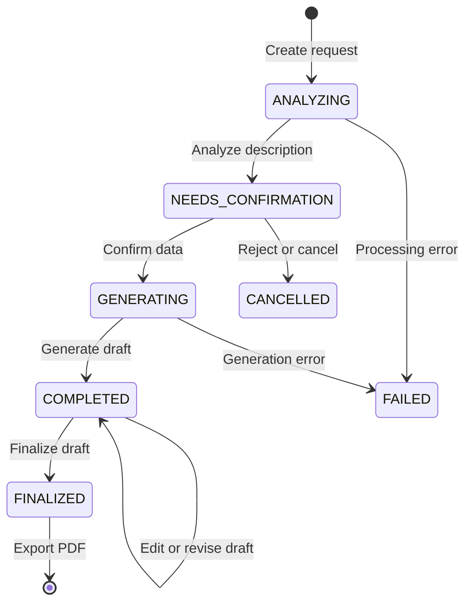
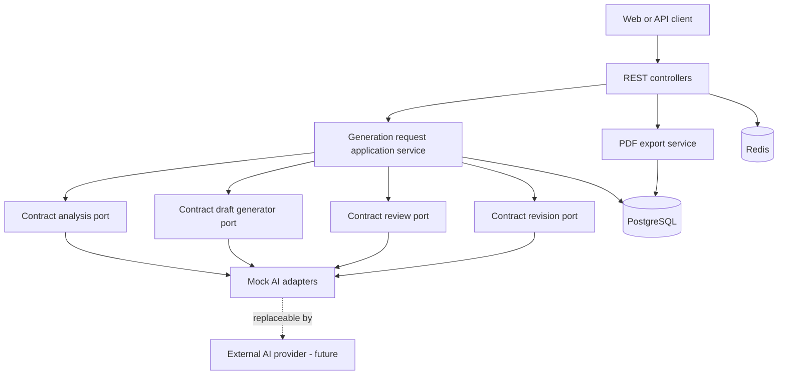
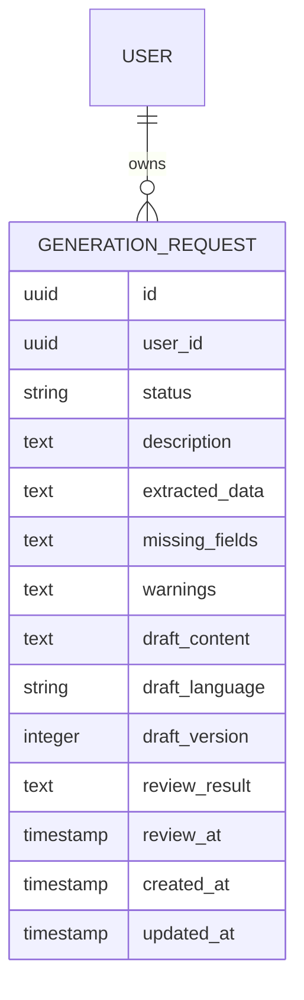

# AquaLex Backend


> **AI-assisted contract generation for frozen seafood exports from Vietnam to Germany and the European Union.**

AquaLex is a backend platform for turning a natural-language business request into a structured, reviewable, and exportable contract draft. It is designed for exporters, importers, logistics teams, sales teams, and contract specialists who need to prepare international frozen-seafood sales contracts faster and more consistently.

The platform combines a guided AI workflow with domain data, ownership controls, draft versioning, review warnings, and PDF export. It is not intended to replace legal counsel or trade-compliance professionals; generated documents must be reviewed before official use.

---

## What AquaLex Does

Traditional contract preparation requires users to collect the same commercial and logistics information repeatedly:

- Seller and buyer legal information.
- Product specifications and packaging.
- Quantity, price, currency, and payment terms.
- Incoterms, ports, transport, and delivery dates.
- Storage and transportation temperature.
- Quality requirements and export documents.

AquaLex lets a user describe the transaction in natural language. The backend then guides the request through a controlled lifecycle:

```mermaid
flowchart LR
    A[Natural-language request] --> B[AI analysis]
    B --> C[Extracted contract data]
    C --> D[Missing fields and warnings]
    D --> E[User confirmation]
    E --> F[Draft generation]
    F --> G[Review]
    G --> H[Edit or AI revision]
    H --> I[Finalization]
    I --> J[PDF export]
```



## Core Value

| Capability | Business value |
|---|---|
| Structured extraction | Converts unstructured descriptions into contract-ready data |
| Missing-field detection | Prevents users from overlooking essential transaction details |
| Review warnings | Highlights inconsistencies and points that require human attention |
| Draft versioning | Preserves a clear history as users edit or revise a contract |
| Ownership enforcement | Ensures users can only access their own requests and contracts |
| PDF export | Produces a finalized document with A4 layout, Times New Roman, and 13pt text |

---

## AI Contract Lifecycle

Each generation request follows an explicit state machine:



### Main workflow

1. The user creates a request with a natural-language description.
2. The system analyzes the description and stores extracted data.
3. Missing fields and warnings are returned for confirmation.
4. The user adds or confirms the missing information.
5. The system generates a contract draft.
6. The user reviews, edits, or asks the system to revise the draft.
7. The user finalizes the approved version.
8. The finalized draft can be downloaded as a PDF.

---

## Current API Journey

All AI contract endpoints require an authenticated bearer token.

| Step | Method | Endpoint | Purpose |
|---:|---|---|---|
| 1 | `POST` | `/api/v1/ai-contracts` | Create a generation request |
| 2 | `GET` | `/api/v1/ai-contracts/{requestId}` | Retrieve request status and results |
| 3 | `POST` | `/api/v1/ai-contracts/{requestId}/analyze` | Analyze the natural-language description |
| 4 | `POST` | `/api/v1/ai-contracts/{requestId}/confirm` | Confirm extracted data and add missing values |
| 5 | `POST` | `/api/v1/ai-contracts/{requestId}/generate` | Generate a contract draft |
| 6 | `POST` | `/api/v1/ai-contracts/{requestId}/review` | Review the draft and store warnings |
| 7 | `PATCH` | `/api/v1/ai-contracts/{requestId}/draft` | Edit the draft directly |
| 8 | `POST` | `/api/v1/ai-contracts/{requestId}/revise` | Ask the AI workflow to revise the draft |
| 9 | `POST` | `/api/v1/ai-contracts/{requestId}/finalize` | Mark the approved draft as final |
| 10 | `GET` | `/api/v1/ai-contracts/{requestId}/export?format=pdf` | Download the finalized draft as PDF |

### Example request sequence

```text
POST /ai-contracts
      ↓
POST /ai-contracts/{id}/analyze
      ↓
POST /ai-contracts/{id}/confirm
      ↓
POST /ai-contracts/{id}/generate
      ↓
POST /ai-contracts/{id}/review
      ↓
PATCH /ai-contracts/{id}/draft
      or
POST /ai-contracts/{id}/revise
      ↓
POST /ai-contracts/{id}/review
      ↓
POST /ai-contracts/{id}/finalize
      ↓
GET /ai-contracts/{id}/export?format=pdf
```

### Create a generation request

```http
POST /api/v1/ai-contracts
Authorization: Bearer <access-token>
Content-Type: application/json
```

```json
{
  "description": "DAT Seafood in Ho Chi Minh City sells 20 tons of frozen whiteleg shrimp to German Food GmbH in Hamburg. The shrimp is packed in 500 gram bags and stored at -18 degrees Celsius. The price is 8 USD per kilogram. Delivery is by sea from Cat Lai Port to Hamburg Port."
}
```

### Confirm extracted data

```http
POST /api/v1/ai-contracts/{requestId}/confirm
Authorization: Bearer <access-token>
Content-Type: application/json
```

```json
{
  "isConfirmed": true,
  "additionalData": {
    "sellerAddress": "12 Nguyen Hue, Ho Chi Minh City, Vietnam",
    "buyerAddress": "Hamburg, Germany",
    "deliveryDate": "2027-01-15",
    "paymentTerm": "Irrevocable Letter of Credit",
    "qualityStandard": "EU food safety requirements"
  }
}
```

### Revise a draft

```http
POST /api/v1/ai-contracts/{requestId}/revise
Authorization: Bearer <access-token>
Content-Type: application/json
```

```json
{
  "instruction": "Rewrite the payment clause in a clearer and more formal style."
}
```

---

## Architecture



### Backend layers

```text
src/main/java/com/aquaLex
├── ai/contract
│   ├── application       # Use-case orchestration and AI ports/adapters
│   ├── controller        # AI contract REST endpoints
│   ├── domain            # GenerationRequest and lifecycle states
│   ├── dto               # API request and response models
│   └── infrastructure    # Persistence repositories
├── auth
│   ├── application       # Authentication use cases
│   ├── controller        # Authentication endpoints
│   ├── domain            # User and token domain models
│   ├── dto               # Authentication request/response models
│   ├── infrastructure    # Authentication repositories
│   └── security          # JWT and security filters
├── contract              # Traditional contract CRUD module
├── common                # Configuration, errors, responses, and security
└── health                # Health-check endpoint
```

The AI integration uses interfaces such as `ContractAnalysisService`, `ContractDraftGenerator`, `ContractReviewService`, and `ContractRevisionService`. This keeps the application workflow independent from a particular model provider. The current mock adapters can later be replaced with OpenAI, Azure OpenAI, Ollama, or another provider.

---

## Data Model

The central aggregate is `GenerationRequest`. It stores:

- Original user description.
- Current lifecycle status.
- Extracted contract data.
- Missing fields and warnings.
- Draft content, language, and version.
- Review result and review timestamp.
- Owner, creation time, and update time.



---

## Authentication and Ownership

The API uses JWT-based authentication:

- Passwords are hashed with BCrypt.
- Access tokens are short-lived JWTs.
- Refresh tokens are stored as hashes.
- Logged-out access tokens are blacklisted in Redis.
- AI requests and contracts are queried with both resource ID and authenticated user email.
- A user cannot read or modify another user's generation request.

Public authentication endpoints:

| Method | Endpoint | Purpose |
|---|---|---|
| `POST` | `/api/v1/auth/register` | Register a user |
| `POST` | `/api/v1/auth/login` | Authenticate a user |
| `POST` | `/api/v1/auth/refresh` | Refresh an access token |

Protected authentication endpoints:

| Method | Endpoint | Purpose |
|---|---|---|
| `GET` | `/api/v1/auth/profile` | Retrieve the current profile |
| `POST` | `/api/v1/auth/logout` | Revoke the current session |

---

## PDF Export

The export endpoint returns a downloadable PDF only after finalization:

```http
GET /api/v1/ai-contracts/{requestId}/export?format=pdf
```

Current PDF characteristics:

- A4 page size.
- Times New Roman font.
- 13pt body text.
- Vietnamese Unicode support when `C:\Windows\Fonts\times.ttf` is available.
- Automatic line wrapping and page creation.
- `Content-Disposition: attachment` download response.

The current renderer provides a stable base for future contract templates. A later template system can preserve a supplied PDF or DOCX layout while AI supplies the structured contract data.

---

## Technology Stack

- Java 21
- Spring Boot 4.1.1
- Spring Web MVC
- Spring Security
- Spring Data JPA
- PostgreSQL
- Flyway
- Redis
- JJWT
- Apache PDFBox
- Springdoc OpenAPI / Swagger UI
- Maven

---

## Local Development

### Prerequisites

- Java 21
- Maven Wrapper included in the repository
- PostgreSQL
- Redis
- Windows Times New Roman font for Vietnamese PDF output

### Configuration

Configure the database, Redis, JWT, and application settings in:

```text
src/main/resources/application.properties
```

Do not commit passwords, tokens, or provider API keys. Use environment variables for secrets.

### Run the backend

```powershell
.\mvnw.cmd spring-boot:run
```

The API is available at:

```text
http://localhost:8080
```

Swagger UI:

```text
http://localhost:8080/swagger-ui/index.html
```

### Build and compile

```powershell
.\mvnw.cmd -q -DskipTests compile
```

Flyway applies database migrations automatically when the application starts.

---

## Project Status

### Implemented

- User registration, login, refresh, profile, and logout.
- JWT authentication and Redis token blacklist.
- User-owned contract CRUD.
- AI generation request lifecycle.
- Structured analysis result storage.
- Confirmation and additional data merging.
- Mock draft generation.
- Mock contract review.
- Direct draft editing with version increment.
- Instruction-based draft revision.
- Finalization workflow.
- PDF export with configurable typography.

### Planned

- Replace mock adapters with a configurable external or local AI provider.
- Upload and parse PDF, DOCX, and text files.
- Conversation history for iterative AI clarification.
- Persistent draft version history.
- Domain-specific validation for Incoterms, quantities, prices, and cold-chain requirements.
- Reusable contract templates based on supplied document layouts.
- PDF/DOCX template rendering with logos, tables, signatures, and page headers.

---

## Disclaimer

AquaLex generates contract drafts and review checklists to support business workflows. It does not provide legal advice, guarantee regulatory compliance, or replace qualified legal, customs, food-safety, or trade professionals.
